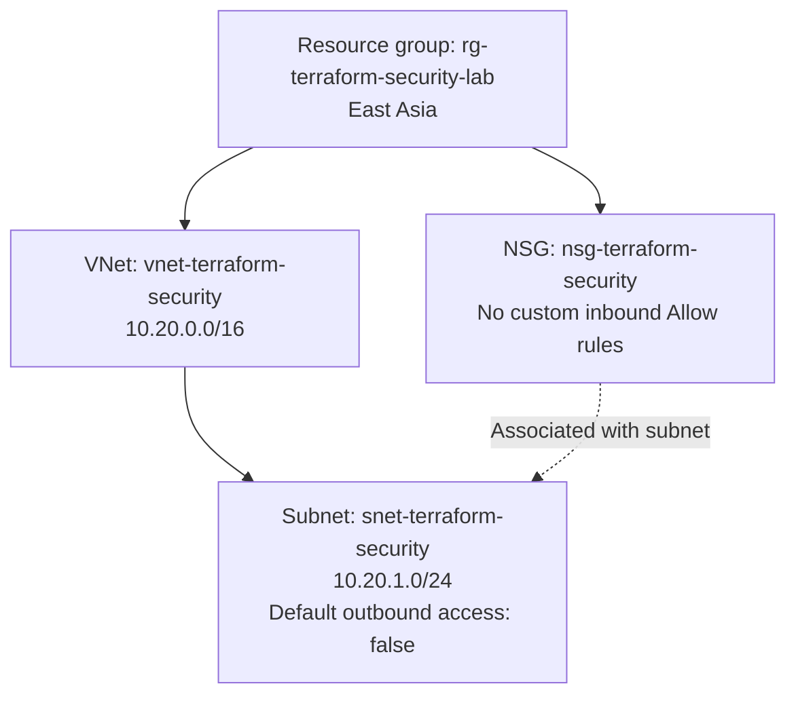

# Azure Secure Infrastructure Deployment with Terraform

## Overview

I built this personal Azure lab to practise deploying and maintaining networking infrastructure with Terraform instead of configuring each resource manually in the Azure Portal. The project focuses on repeatable deployments, subnet-level NSG association, and a documented change to the subnet's default outbound access setting.

**Scope:** This is a configuration and deployment lab, not a penetration test or proof that all inbound and outbound traffic is blocked. No VM, public IP address, NAT gateway, Azure Bastion, or Azure Firewall was deployed.

## Technologies

Terraform · HashiCorp AzureRM provider · Microsoft Azure · Azure CLI · PowerShell · Git

## Infrastructure

| Component | Configuration |
|---|---|
| Resource group | `rg-terraform-security-lab` |
| Region | East Asia (`eastasia`) |
| Virtual network | `vnet-terraform-security` — `10.20.0.0/16` |
| Subnet | `snet-terraform-security` — `10.20.1.0/24` |
| Network Security Group | `nsg-terraform-security` |
| NSG association | Attached to `snet-terraform-security` |
| Default outbound access | Disabled (`false`) |

Five resources are tracked by Terraform: the resource group, virtual network, subnet, NSG, and subnet–NSG association.

## Architecture



The diagram represents Azure configuration, not live traffic or an internet-accessible service.

## Implementation

1. Configured the AzureRM provider and authenticated locally using Azure CLI.
2. Used Terraform to provision the resource group, VNet, subnet, and NSG and associate the NSG with the subnet.
3. Checked the deployment against Azure using Terraform state, Terraform plan, and Azure CLI.
4. Identified that Azure's default outbound access setting was enabled on the subnet.
5. Updated the subnet resource in `main.tf` to specify:

   ```hcl
   default_outbound_access_enabled = false
   ```

6. Verified the final Azure subnet setting through Azure CLI.

### Observed results

Initial deployment:

```text
Apply complete! Resources: 5 added, 0 changed, 0 destroyed.
```

After configuration and verification:

```text
No changes. Your infrastructure matches the configuration.
```

Azure CLI reported:

```json
{
  "DefaultOutboundAccess": false,
  "Subnet": "snet-terraform-security"
}
```

The final value is verified. I did not retain evidence identifying exactly which operation changed the setting from `true` to `false`, so I do not claim a particular apply run made that change.

## Security considerations

- **No internet-facing workload:** There were no VMs or public IP addresses in the lab.
- **Subnet-level NSG:** The NSG is associated with the intended subnet.
- **Inbound access:** No custom inbound Allow rules were configured. Azure's built-in NSG rules still apply; this is not a deny-all network.
- **Outbound access:** Disabling implicit default outbound access prevents reliance on Azure's default outbound connectivity. It does **not** block all possible outbound paths, including explicitly configured connectivity.
- **State protection:** Terraform state, plan files, local variable files, and credential files are excluded from Git. Terraform state can contain sensitive values and should not be published.
- **Version consistency:** `.terraform.lock.hcl` is committed to record the selected provider versions.

## Reproducing the lab

### Prerequisites

- Azure subscription with permission to create resource groups and networking resources
- Terraform and Azure CLI installed locally
- An Azure-supported region permitted by the subscription

### Authenticate

```powershell
az login
az account show --query "{Name:name,State:state}" -o table
$env:ARM_SUBSCRIPTION_ID = az account show --query id -o tsv
```

Confirm that the selected Azure subscription is your own before proceeding.

### Validate and preview

```powershell
terraform init
terraform fmt -check
terraform validate
terraform plan
```

Review resource names, region, network settings, and all proposed changes before deployment.

### Deploy

```powershell
terraform apply
```

### Verify

```powershell
terraform state list
terraform plan
az network vnet subnet show `
  --resource-group rg-terraform-security-lab `
  --vnet-name vnet-terraform-security `
  --name snet-terraform-security `
  --query "{Subnet:name,NSG:networkSecurityGroup.id,DefaultOutboundAccess:defaultOutboundAccess}" `
  --output json
```

## Cleanup

When finished, review the destruction plan before deleting the lab:

```powershell
terraform plan -destroy
terraform destroy
```

**Do not delete local Terraform state until you have confirmed the managed resources are removed.**

## What I learned

- Writing reproducible Azure network infrastructure with Terraform
- Understanding dependencies between VNets, subnets, NSGs, and associations
- Using Terraform state and plans to review configuration drift
- Verifying Azure settings with Azure CLI rather than relying on code alone
- Handling sensitive Terraform files safely in version control

## Automated CI and security scanning

The [GitHub Actions workflow](.github/workflows/terraform-security.yml) runs on Terraform changes to `main`, pull requests, or manual dispatch. It checks:

- `terraform fmt -check -recursive` — formatting consistency.
- `terraform init -backend=false -input=false` and `terraform validate -no-color` — provider setup and configuration validation without accessing an Azure backend.
- Checkov static analysis — scans Terraform configuration for security findings and fails its job if checks fail.

**Verified CI result:** Both Terraform validation and Checkov completed successfully in the workflow run associated with commit `e0fbba0`: [view run](https://github.com/ahneoaseiyo/azure-secure-infrastructure-terraform/actions/runs/43219573109).

The workflow does not authenticate to Azure or apply infrastructure changes. A passing static scan does not prove the deployed environment is secure.

## Potential next steps

- Refactor resources into reusable Terraform modules
- Add CI validation (`terraform fmt -check` and `terraform validate`)
- Add IaC security checks and document findings
- Investigate remote-state storage and its access controls
- Review outbound routing and NSG policy in a separate, controlled scenario
